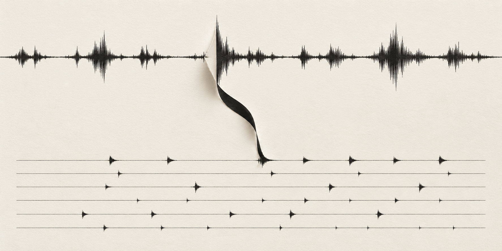
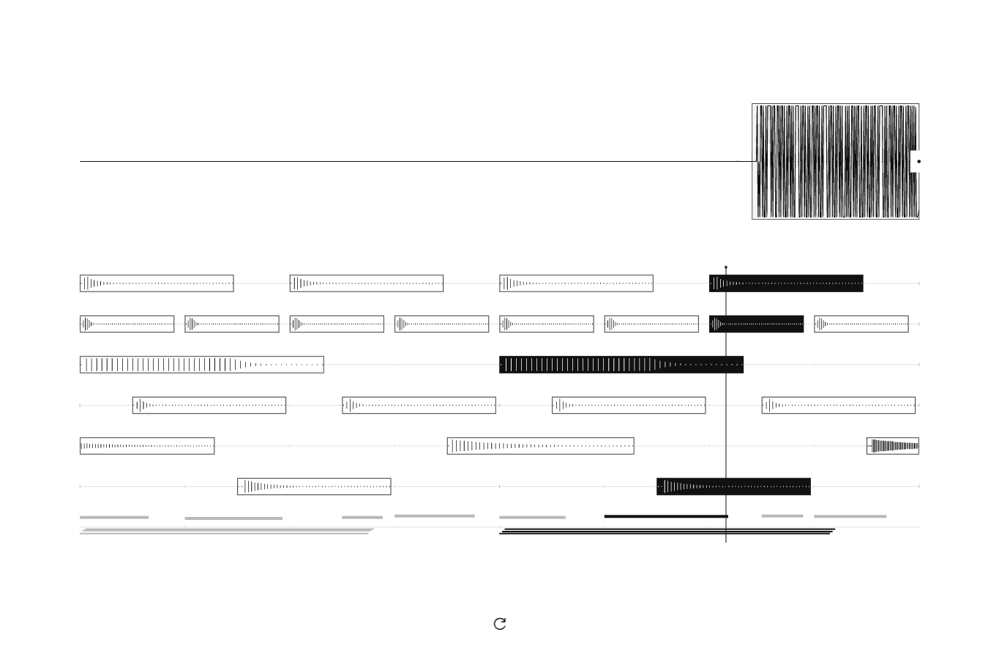
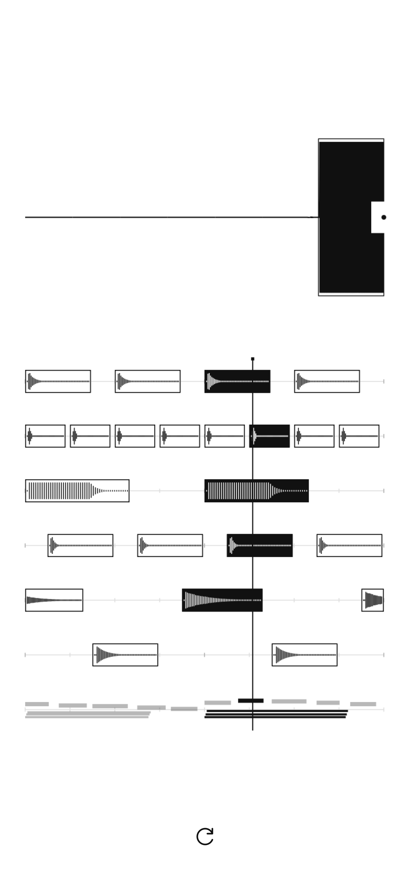

<h1 align="center">Nois(ampl)e</h1>

<p align="center"><strong>The room is already playing.</strong></p>
<p align="center"><em>Catch a peak. Give it a pulse. Let it go.</em></p>

<p align="center">
  <a href="https://taewooopark.github.io/noisample/">Open Nois(ampl)e</a> ·
  <a href="#the-entire-workflow">Workflow</a> ·
  <a href="#six-voices-one-room">Voices</a> ·
  <a href="#development">Development</a>
</p>

<p align="center">
  
  
  
  
</p>

<p align="center">
  
</p>

## Why Nois(ampl)e?

A cup meets a table. A chair shifts. Someone laughs across the room. These sounds pass through the day without asking to become music. Repeat one of them, and something changes: you begin to expect its return. An accident acquires a place in time.

Nois(ampl)e makes that small change audible. A peak opens a recording window long enough to keep a voice, a scrape or a sound's decay recognizable. That recording returns at its original pitch and speed, given a place in a steady beat. The clock stays at 110 BPM while the room supplies the texture. A familiar rhythm holds together sounds that have never met before.

Read the parentheses in **Nois(ampl)e** as an amplifier inside noise: a reminder that attention can make an ordinary sound feel larger. The screen follows the same idea. One passing waveform becomes six lines of recurring fragments. There are no visible words or instrument controls to negotiate; you make a sound and hear what happens to it.

The piece lasts for a visit. Refresh, and its collected sounds disappear. The next beat begins with whatever is happening now.

Once six different roles have found their sounds, a keyboard joins them. Its melody answers the rhythm already in the room. The recordings remain recognizable; harmony gives them somewhere to arrive.

## Start in 60 seconds

[Open Nois(ampl)e](https://taewooopark.github.io/noisample/), tap the screen and allow microphone access. Clap, tap a surface or make a short vocal sound. Watch each captured fragment travel into a lane, then listen as the playhead returns to it.

<p align="center">
  <a href="https://taewooopark.github.io/noisample/">
    
  </a>
  <br>
  <a href="https://taewooopark.github.io/noisample/">Scan, touch, listen.</a> ·
  <a href="./docs/assets/qr.svg">Print the QR</a>
</p>

Keep the page open while playing. Headphones help separate the room's sound from the beat coming back through the microphone. The refresh icon clears the session and immediately collects again using the existing microphone connection. If the browser interrupts audio, a tap anywhere on the canvas retries playback without reloading the page.

## The entire workflow

```text
1. Touch. Let the browser connect to your microphone.
2. Make a sound. A peak rises above the surrounding level.
3. Hear the pulse. The first recording repeats on every quarter note.
4. Add contrast. Different sounds find suitable roles around that pulse.
5. Hear it open up. When all six roles are filled, a keyboard enters on the next bar.
6. Refresh. Let this room's rhythm go and start another.
```

Sampling, placement and playback are automatic. Every session starts with the same simple, straight **4/4 groove at 110 BPM**. The first accepted recording goes to the role its sound suits and repeats every **545 ms: four times per bar**. It stays there until reset, giving later sounds a stable pulse to join.

The first recording starts on beat one about 300 ms after capture completes, rather than waiting for the current empty loop to come around. Its full-length tails may overlap; they are never cut short to fit a quarter note. The other five lanes use sparse supporting positions and make space for complete recordings. There is no initial random syncopation or swing.

## Six voices, one room

| Lane, top to bottom | The recording's role in the rhythm |
|---|---|
| Kick | Low, short impacts such as a desk thud establish the low pulse. |
| Clap / snare | A quick, broad burst such as a handclap lands on the backbeat. |
| Bass | Low resonances or sustained low sounds support the bass pattern, at their original pitch. |
| Closed hi-hat | Short, bright sounds occupy sparse hat positions. |
| Open hi-hat | Bright sounds with longer ringing tails become open-hat accents. |
| Percussion | Midrange knocks and resonances add supporting accents. |

Frequency-band energy, spectral shape, attack and decay guide assignment; this analysis does not alter the recording. Empty lanes take priority only among compatible roles. Repeating a clap will not fill the bass lane just because it is empty. Low impacts can serve kick or bass; a bright clap can serve clap or hat. These are acoustic heuristics, so a hollow desk, a padded desk and different microphones can yield different assignments.

The first recording anchors whichever lane it belongs to with all four beats. Each other lane holds up to three recordings, limited by the positions that can fit complete clips; new arrivals eventually replace its oldest sound. Supporting patterns can become sparser as longer sounds arrive. Try a low desk thud, a clap, a low hum, a short bright tap, ringing keys or coins, and a midrange wooden knock to explore the six roles.

The six instrument names describe rhythmic roles, not sound transformations. Every microphone lane plays its captured audio in full at its original pitch and speed. There is no pitch shifting, filtering, distortion, normalization, grain looping or drum-shaped decay on these recordings. A voice assigned to the kick lane remains that voice. The rhythm uses no prerecorded drum pack, generative model or remote audio service.

## When the keyboard arrives

All six roles must contain a suitable recording before the accompaniment begins. It enters on the next complete bar after the final recording lands. A seventh line appears for the keyboard notes; the page keeps the same white canvas, black marks and single reset control.

The accompaniment has **12 keyboard colors**: grand piano, FM piano, marimba and vibraphone recordings, plus eight synthesized keys spanning felt, glass, plucked, warm electric, bell, hollow, airy and analog tones. Eight-bar phrases combine four scale families, eight chord paths, eight rhythm motifs and eight melodic contours. Each phrase develops its response and changes keyboard color; reset chooses a new musical seed. Soft, closely voiced chords support the lead. A stable low pitched recording can suggest the key without retuning that recording.

Only this added keyboard layer uses prepared instrument recordings and synthesis. Its samples come from the same licensed collections used by [Loopify](https://github.com/TaewoooPark/loopify): Salamander Grand Piano (CC BY 3.0) and VCSL (CC0). [Credits, source revision and checksums](./dist/samples/CREDITS.md) are included. Asset loading runs independently of microphone startup, and native keys provide a fallback when a recording cannot load.

## A small control dictionary

| What you see or do | What it means |
|---|---|
| Touch the canvas / focus it and press `Enter` or `Space` | Starts the microphone and audio, or resumes an interrupted session. |
| Microphone outline | Ready to start. |
| Rotating arc | Waiting for microphone access. |
| Small black dot | Listening and collecting. |
| Crossed microphone | Access was denied or the microphone could not connect. Check the browser's site permissions, then touch again. |
| Pause mark | Audio was interrupted; touch to resume. |
| Moving vertical line | The current position in the two-bar loop. |
| Expanding selection around the input waveform | A longer recording is being collected. |
| First recording's sample cells | Quarter-note starts in its assigned row; each cell flashes on its beat while the complete audio tail continues. |
| Width of other sample blocks | The recording's actual duration; they stay dark for their complete playback. |
| Seventh row with small pitched marks | The keyboard accompaniment, appearing after all six sample roles are filled. |
| Refresh icon | Discards every sample and restarts collection without reloading or reopening microphone permission. |
| Browser reload | Opens a new empty session; tap to unlock audio again. |

Status messages are available to screen readers. Reduced-motion preferences remove the traveling sample animation while preserving the waveform and timing display.

## From a peak to a pulse

An `AudioWorklet` measures the input against an adaptive noise floor. A minimum threshold, onset check, quiet rearm period and cooldown keep silence and sustained sounds from filling the sampler repeatedly. Captures include 32 ms of pre-roll and last roughly **0.8–1.8 seconds**. After the minimum duration, a recording ends when the sound has stayed quiet for 240 ms, or when the maximum duration is reached. Short pauses within a phrase can remain inside the recording.

The captured PCM is copied unchanged into the playback buffer. Every role uses that buffer once, from beginning to end, at playback rate 1. Only a 3 ms fade at each edge prevents boundary clicks; one fixed master gain leaves headroom for six lanes. The recording's natural volume changes and decay remain intact. There is no compressor or role-specific processing.

The first clip establishes beat one after its 300 ms placement animation. Later clips join on a sixteenth-note boundary. Web Audio's clock schedules the sound independently of the canvas animation. The anchor lane allows up to four complete overlapping copies at the maximum capture length; the other lanes account for clip duration and the loop boundary, skipping a new start if that lane's previous clip is still playing. A fixed microphone master gain of 0.085 leaves room for those tails and the separate, bounded keyboard mix without a compressor.

Playback-aware thresholding and the browser's microphone echo cancellation help reduce self-triggering. Echo cancellation is requested at capture time, while browser noise suppression and automatic gain control are disabled. Device and browser microphone processing can still affect the input they deliver.

The threshold uses **dBFS**, the microphone signal's digital level. It is not a calibrated measurement of environmental sound pressure in dB SPL. Sensitivity and feedback depend on the device, its speaker level and the room.

## Let the moment pass

Captured audio stays in this page's memory. It is never uploaded or written to browser storage. Refreshing or closing the page releases the recordings. Each phone builds its own beat; sessions are not synchronized across devices.

There is no save, export or account flow. The reset button belongs to the instrument: it makes room for a different set of sounds and a different moment of attention.

## The instrument in view

| At a desk | In your pocket |
|---|---|
|  |  |

These are actual interface captures driven by a synthetic microphone during browser testing. The cover image is an AI-generated interpretation of the instrument, separate from the interface screenshots. Its [generation prompt and provenance](./docs/assets/hero-prompt.md) are included.

## Development

Node.js 24 recommended. There are no runtime packages to install and no build step.

```bash
git clone https://github.com/TaewoooPark/noisample.git
cd noisample
npm run dev

npm run check
npm test
```

The local server runs at `http://localhost:4173`. `dist/capture-worklet.js` detects and extracts transients. `dist/analysis.js` measures recordings and selects compatible roles. `dist/engine.js` manages the microphone, raw sample voices and shared audio clock. `dist/patterns.js` defines the starter groove and placement timing. `dist/melody.js` generates and plays the keyboard phrases. `dist/app.js` draws the waveform, sample movement and sequencer. Tests exercise capture, frequency classification, PCM preservation, timing, the six-role melody gate, reset and permission recovery.

Startup loads the worklet alongside microphone permission and never waits for an unresolved `AudioContext.resume()` promise before building the capture graph. Completed taps can retry audio even while setup is pending. A bounded recovery checks the audio clock or worklet heartbeat; if a context stays stalled, the next tap can rebuild it with the existing live microphone. Reset keeps that connection instead of navigating away.

Pushes to `main` run checks and tests, then publish `dist/` through GitHub Pages. Relative module and worklet URLs support the `/noisample/` project path. No application server or API credentials are required.

Microphone access needs HTTPS or localhost and a user gesture. A phone opening a development machine's LAN HTTP address does not get the localhost exception. Open the published site directly in a current browser if an embedded preview blocks microphone access. Locking the phone, taking a call or changing apps may interrupt audio; return to the page and touch to resume.

Desktop and phone-sized browser layouts and synthetic microphone playback have been checked. Physical iOS/Android microphone behavior and acoustic feedback remain device-testing work.

---

Made by [Taewoo Park](https://taewoopark.com) · [GitHub](https://github.com/TaewoooPark)

*Aligning physics, code, and culture toward a civilization-scale solution.*
